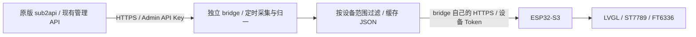

# 在 ESP32-S3 上展示 sub2api 账号数据的方案

按你的约束，推荐在本 ESP32 项目中开发一个**独立 bridge 程序，只调用 sub2api 已有 HTTP API**，将结果整理为小份 JSON，再由 ESP32-S3 通过 HTTPS 读取并用 LVGL 显示。sub2api 保持原版部署；这套方案不包含修改其源码、新增其接口或直接访问其数据库/Redis。

本方案按你确认的优先级设计：**健康总览＋重点账号额度＋今日用量**。你提供的设备为 ESP32-S3-WROOM-1-N16R8，带 16 MB Flash、8 MB PSRAM、320×240 ST7789 SPI 屏幕及 FT6336 电容触摸，足以承载这类界面。硬件参数保存在[原始参数图](research/esp32-s3-hardware-spec.png)。

分析及修订日期：2026-10-04。代码基准：[Wei-Shaw/sub2api](https://github.com/Wei-Shaw/sub2api) 的 `main`，提交 `b8dece9000c68815a5b867ca5a1e6f236e173905`。本方案已在本项目中实现为独立 bridge 和 ESP32-S3 固件，并完成 bridge 测试、浏览器预览、构建、烧录及自动化实机网络验收；详细结果见[实施记录](implementation-status.md)。完整依据见[后端证据笔记](research/sub2api-backend-evidence.md)。如果也不希望运行独立程序，第 6 节给出 ESP32 直接调用现有 API 的路径。

## 1. 账号页面实际怎样取得数据

项目是 Vue 3/Vite 前端与 Go/Gin 后端；账号配置和本地消费统计来自 PostgreSQL，并发、会话、RPM 等运行数据来自 Redis。`/admin/accounts` 是需要管理员权限的前端路由；实际账号接口位于 `/api/v1/admin/accounts`。入口见[前端路由](https://github.com/Wei-Shaw/sub2api/blob/b8dece9000c68815a5b867ca5a1e6f236e173905/frontend/src/router/index.ts#L517)、[API 基址](https://github.com/Wei-Shaw/sub2api/blob/b8dece9000c68815a5b867ca5a1e6f236e173905/frontend/src/api/url.ts#L1)和[服务端路由入口](https://github.com/Wei-Shaw/sub2api/blob/b8dece9000c68815a5b867ca5a1e6f236e173905/backend/internal/server/router.go#L120)。

页面由账号列表和补充查询组合而成。下载 `/admin/accounts` 的 HTML 不能取得这些运行数据；bridge 应读取现有 JSON API。

| 数据 | 现有接口/来源 | 使用方式 |
| --- | --- | --- |
| 名称、平台、类型、状态、调度开关、限流/冷却/过载、容量、到期时间 | `GET /api/v1/admin/accounts?lite=1&include_scheduler_score=0` | 分页取列表，作为状态与保存快照的主来源 |
| 指定账号详情、并发 | `GET /api/v1/admin/accounts/:id` | 少量固定账号可逐个读取，避免频繁扫描全站 |
| 今日请求、Token、费用 | `GET /api/v1/admin/accounts/:id/today-stats` | 首版重点账号优先用此接口，SQL 错误会返回错误 |
| 批量今日统计 | `POST /api/v1/admin/accounts/today-stats/batch`，请求 `{"account_ids":[101,102]}` | 有 30 秒缓存，但降级失败会补零，不能提供逐账号错误保证 |
| 已有渠道监控额度 | `GET /api/v1/admin/channel-monitors`，读取 `account_id` 与 `latest_quota` | 功能已启用且存在绑定账号的 quota 监控时，读取保存的多平台快照 |
| 单账号用量 | `GET /api/v1/admin/accounts/:id/usage` | Anthropic OAuth/SetupToken 可用 `source=passive`；其余平台默认路径可能主动查询 |
| 批量用量 | `POST /api/v1/admin/accounts/usage/batch`，请求 `{"account_ids":[101,102],"force":false}` | Anthropic 走被动分支，其他平台可能访问供应商或更新既有状态 |
| 国产供应商额度/余额 | 列表 `extra` 的快照；另有 `GET /api/v1/admin/cn-providers/accounts/:id/quota` 和 `/balance` | 优先保存快照；后两者是会访问上游的现有探测接口 |
| Ollama Cloud/OpenCode Go | 列表里的独立 usage state/snapshot | 读取已保存窗口和采样时间 |
| 历史消费图 | `GET /api/v1/admin/accounts/:id/stats?days=30` | 第二阶段详情可用，首版不需要历史大响应 |

页面初始列表明确使用 `lite=1`，额度单元格合并成 batch，前端用量缓存为 5 分钟；自动刷新选项为 5/10/15/30 秒且默认关闭。列表 ETag 与额度、今日统计分别刷新。见[列表配置](https://github.com/Wei-Shaw/sub2api/blob/b8dece9000c68815a5b867ca5a1e6f236e173905/frontend/src/views/admin/AccountsView.vue#L1066)、[用量缓存](https://github.com/Wei-Shaw/sub2api/blob/b8dece9000c68815a5b867ca5a1e6f236e173905/frontend/src/views/admin/AccountsView.vue#L720)、[自动刷新](https://github.com/Wei-Shaw/sub2api/blob/b8dece9000c68815a5b867ca5a1e6f236e173905/frontend/src/views/admin/AccountsView.vue#L1445)和[全部列定义](https://github.com/Wei-Shaw/sub2api/blob/b8dece9000c68815a5b867ca5a1e6f236e173905/frontend/src/views/admin/AccountsView.vue#L1787)。

管理端监控**列表**会附加 `latest_quota`，单条 `GET /admin/channel-monitors/:id` 不做同样的快照聚合。列表需要功能启用，但不受用户端 `show_quota` 限制；管理端 guard 也没有要求 mode=v1。不能据此推断 V2 模式仍在刷新旧 V1 监控，旧快照须检查时间。见[列表聚合](https://github.com/Wei-Shaw/sub2api/blob/b8dece9000c68815a5b867ca5a1e6f236e173905/backend/internal/handler/admin/channel_monitor_handler.go#L250)、[管理 DTO](https://github.com/Wei-Shaw/sub2api/blob/b8dece9000c68815a5b867ca5a1e6f236e173905/backend/internal/handler/admin/channel_monitor_handler.go#L117)和[功能 guard](https://github.com/Wei-Shaw/sub2api/blob/b8dece9000c68815a5b867ca5a1e6f236e173905/backend/internal/server/routes/admin.go#L868)。

成功响应为 `{"code":0,"message":"success","data":...}`。前端 Axios 自动解包；bridge 需要检查 HTTP 状态、`code` 和 `data`。见[前端解包](https://github.com/Wei-Shaw/sub2api/blob/b8dece9000c68815a5b867ca5a1e6f236e173905/frontend/src/api/client.ts#L93)。

## 2. 必须保留的数据口径

### 健康和状态

`status=active` 与 `schedulable=true` 是账号状态与调度配置。bridge 根据列表字段显示错误、暂停、有效限流、过载、临时冷却、到期和本地额度告警，保留多项 flags，并按账号 ID 去重计算告警账号数。

首页使用“**列表状态正常 X/Y**”，输出字段为 `observed_normal`，依据标为 `admin_list_fields`。它是读取到的状态推断，不是后端 `Account.IsSchedulable()` 的结果，更不是所有模型实时可用性。该内部方法还考虑到期自动暂停及本地配额窗口重置；现有列表没有直接返回它的计算结果，外部 bridge 不能调用内部服务。状态显示可参照[页面状态组件](https://github.com/Wei-Shaw/sub2api/blob/b8dece9000c68815a5b867ca5a1e6f236e173905/frontend/src/components/account/AccountStatusIndicator.vue#L178)，调度边界见[基础调度条件](https://github.com/Wei-Shaw/sub2api/blob/b8dece9000c68815a5b867ca5a1e6f236e173905/backend/internal/service/account.go#L182)。

`observed_normal` 判断 active、调度开关及上述已知阻断字段；本地额度按返回的 used/limit 标记“列表报超限”，不自行宣称其周期已重置。数据缺失或过期时状态标未知/过期。额度 85% 等提醒与状态正常可以同时出现，不能因额度预警直接称账号不可调度。模型级限流和影子账号维度保留为详情。

### 今日统计

今日数据来自 sub2api 的 `usage_logs`，按**sub2api 服务配置时区的当天 00:00**开始。现有账号统计响应不返回日期/时区，设备发送时区参数也不会改变口径。bridge 必须配置与实际部署一致的 `sub2api_timezone`，才能补充 `day.date`、`timezone` 和日界线；不能仅凭电脑或设备时区猜测。见[服务时区初始化](https://github.com/Wei-Shaw/sub2api/blob/b8dece9000c68815a5b867ca5a1e6f236e173905/backend/internal/repository/ent.go#L107)和[Today helper](https://github.com/Wei-Shaw/sub2api/blob/b8dece9000c68815a5b867ca5a1e6f236e173905/backend/internal/pkg/timezone/timezone.go#L97)。

| 字段 | 现有 SQL 口径 | 界面标签 |
| --- | --- | --- |
| `requests` | `COUNT(*)` | 本站今日请求 |
| `tokens` | 输入＋输出＋缓存创建＋缓存读取 Token | 本站今日 Token，含缓存 |
| `cost` | `SUM(COALESCE(account_stats_cost,total_cost) * COALESCE(account_rate_multiplier,1))` | 账号费用 |
| `user_cost` | `SUM(actual_cost)` | 用户计费 |
| `standard_cost` | `SUM(total_cost)` | 标准费用 |

首页默认账号费用，今日页可查看另外两种费用。它们均是本站计费口径，不是供应商账单或余额。SQL 实际条件是 `created_at>=today`，`day.end_at` 是 bridge 补充的显示日界线。精确实现见[今日 SQL](https://github.com/Wei-Shaw/sub2api/blob/b8dece9000c68815a5b867ca5a1e6f236e173905/backend/internal/repository/usage_log_repo_stats.go#L275)。

一次今日采集开始与完成时都检查该时区日期；跨日则丢弃这一轮并重采。日期切换后，昨天的数据只可作为带旧日期的历史值，不能沿用为今天的零值或汇总。多个账号查询不是数据库事务快照，应保留本轮采集时间范围。

### 额度

| 账号类别 | 现有 API 能读取的来源 | 显示和缺失处理 |
| --- | --- | --- |
| Anthropic OAuth/SetupToken | 被动 usage，以及列表 `session_window_utilization`、`passive_usage_7d_*` 和采样时间 | 区分真实百分比、状态估算、未采样；被动结果没有 Sonnet 时不补零 |
| OpenAI OAuth/Codex | 列表 `extra.codex_5h_*`、`codex_7d_*`、`codex_usage_updated_at` | canonical 字段优先；primary/secondary 按窗口分钟数解释；Spark 单独标注 |
| Gemini | 已有 monitor quota；或现有 usage 接口的本地策略＋日志估算 | 标为本地估算；只读保存模式没有快照时显示未采样 |
| Antigravity | 已绑定账号的 monitor `latest_quota`；或现有 usage 接口 | 保留模型、积分和重置维度；外部程序不能直接读取私有进程缓存 |
| Grok | 列表 `grok_usage_snapshot`、`grok_billing_snapshot`；已有 monitor quota | 区分上游请求/Token、计费和本地控制；没有响应头样本时标未知 |
| Kimi/Zhipu/DeepSeek/MiniMax/OpenCode Go 等 | 列表 `extra` 的计划窗口/余额，或已有 monitor quota | 按实际 eligible/类型显示，保留余额币种 |
| Ollama Cloud/OpenCode Go 独立 state | 列表 `ollama_cloud_usage.snapshot` / `opencode_go_usage.snapshot` | 读取已有窗口及 fetched_at，不调用刷新 POST |
| API Key/Bedrock | 列表的日、周、总费用 used/limit | 标为本地额度控制；limit<=0 表示未启用，不显示成 0% 已用 |

窗口包含 `key`、`label`、`kind`、`dimension`、`used_percent`、`remaining_percent`、`reset_at`、`source_updated_at` 和 `quality`。`kind` 区分上游额度、本地控制、本地估算；`quality` 区分 observed、estimated、api_reported、stale、unknown。Anthropic 原始 `session_window_utilization` 是 0–1 比例，需乘 100；usage 返回的 utilization 已是百分比，不再乘 100。真实百分比存在时剩余为 `max(0,100-used_percent)`；原值可超过 100%，只裁剪进度条。不同账号、模型和币种不相加为一个“总额度”，也不由百分比和本站费用反推真实剩余美元。

额度采集提供两种明确配置：默认 **saved 模式**读已有列表/监控快照，Anthropic 可调用已有被动接口；缺少样本就显示未采样。需要与页面主动额度查询一致时，为选定账号配置 **existing_usage 模式**，后台低频调用原有 usage 或 CN quota/balance 接口，使用 `force=false`/不加 force，并记录返回错误。此模式可能触发 sub2api 已有的供应商查询、生成 probe、状态回写或清除可恢复错误；外部 bridge 无法改变这些既有行为，也不能把 `force=false` 当作全平台禁止主动查询。见[批量分发](https://github.com/Wei-Shaw/sub2api/blob/b8dece9000c68815a5b867ca5a1e6f236e173905/backend/internal/service/account_usage_service.go#L514)和[OpenAI probe](https://github.com/Wei-Shaw/sub2api/blob/b8dece9000c68815a5b867ca5a1e6f236e173905/backend/internal/service/account_usage_service.go#L840)。两种模式都只使用现有接口。

### 读取失败和无样本

bridge 能处理显式 HTTP/业务错误、字段缺失和过期样本；它不能恢复 API 已经吞掉的内部错误：

- 列表 Redis 并发读取失败可能返回 `0`。保留该返回值并标记为 API 报告，不能声称已验证 Redis 正常，也不能把所有合法零值改成未知。并发是本站占槽/租约计数。[并发处理](https://github.com/Wei-Shaw/sub2api/blob/b8dece9000c68815a5b867ca5a1e6f236e173905/backend/internal/handler/admin/account_handler.go#L729)
- 今日 batch 的批量及降级查询都失败后可能补零。首版少量重点账号改用会向 HTTP 层返回查询错误的单账号 GET，失败保留旧值并标过期/未知。[单账号错误传播](https://github.com/Wei-Shaw/sub2api/blob/b8dece9000c68815a5b867ca5a1e6f236e173905/backend/internal/handler/admin/account_handler.go#L2662)、[批量降级](https://github.com/Wei-Shaw/sub2api/blob/b8dece9000c68815a5b867ca5a1e6f236e173905/backend/internal/service/account_usage_service.go#L1410)
- Anthropic 被动 5h 无样本可能构造 0%，也可能按状态估算 80%/100%。需要结合列表的原始窗口/采样证据标记，不能只看 usage 的数字。[被动估算](https://github.com/Wei-Shaw/sub2api/blob/b8dece9000c68815a5b867ca5a1e6f236e173905/backend/internal/service/account_usage_service.go#L1705)
- HTTP 200、`UsageInfo.updated_at` 或 monitor `fetched_at` 不一定代表供应商刚采样。monitor fetched_at 是监控采集时间；有真实 `passive_usage_sampled_at`、`codex_usage_updated_at` 或来源 snapshot 时间时优先保留，否则明确为 API 报告时间。[monitor 时间构造](https://github.com/Wei-Shaw/sub2api/blob/b8dece9000c68815a5b867ca5a1e6f236e173905/backend/internal/service/channel_monitor_quota_fetcher.go#L232)

## 3. 推荐结构：sub2api 外部的独立 bridge



bridge 放在本仓库的 `bridge/`，作为独立进程或容器部署在 sub2api 可达的电脑/NAS/服务器上。它只走 HTTP，不链接 sub2api 的 Go 包，不读数据库或 Redis，不向 sub2api 注册路由。以下路径和 Token 都属于 bridge 自己。

1. **配置范围与别名。** 首版在 bridge 本地配置选定账号 ID、短别名、服务时区、额度采集模式、刷新间隔和设备 Token 哈希。默认总览与今日均覆盖选定账号，屏幕标注“重点账号”。如需全站总览，必须完整分页采集并单独标明全站范围。
2. **管理员凭据留在 bridge。** 使用现有 `x-api-key: <Admin API Key>` 调用管理 API。这是全局管理凭据，既非普通网关 Key，也没有只读/账号 scope。设备只得到 bridge 本地的展示 Token；账号范围校验由 bridge 实现，不声称 sub2api 已支持设备权限。使用已有管理员凭据；重新生成 Admin API Key 会覆盖旧值，不能作为 bridge 初始化的自动步骤。[管理鉴权](https://github.com/Wei-Shaw/sub2api/blob/b8dece9000c68815a5b867ca5a1e6f236e173905/backend/internal/server/middleware/admin_auth.go#L24)、[Key 生命周期](https://github.com/Wei-Shaw/sub2api/blob/b8dece9000c68815a5b867ca5a1e6f236e173905/backend/internal/service/setting_features.go#L569)
3. **分页与固定账号读取。** 发现账号可用 `GET /api/v1/admin/accounts?lite=1&include_scheduler_score=0&page=1&page_size=100&sort_by=id&sort_order=asc`，逐页读取到结束，再按配置 ID 筛选。列表没有 `account_ids` 过滤参数。固定少量账号之后，可每 30 秒逐个 GET 详情、以较慢节奏重扫列表；大范围使用分页列表。没有全收集成功时保留上轮完整数据并标 partial；不要把第一页当全部。跨页并非事务快照，总数变化/缺失时需重采或标不完整。[排序实现](https://github.com/Wei-Shaw/sub2api/blob/b8dece9000c68815a5b867ca5a1e6f236e173905/backend/internal/repository/account_repo.go#L1175)
4. **今日与额度分开采集。** 重点账号今日逐个 GET，限制约 2 个并发；对同一天完整成功的一轮求和。失败账号保留其旧值并标 stale，完整今日总数标 partial，不能把不同日或缺失账号作为零相加。额度按上一节选择保存模式或现有 usage 模式；多个设备的账号并集去重采集。
5. **逐字段构造设备 JSON。** 下发别名、平台、观察到的状态原因、容量、额度窗口和今日统计。列表 `lite=1` 仍带 credentials/extra/代理/身份等信息，不能直接转发。只在 bridge 内解析所需字段，设备 JSON 不包含原始 Account、完整 extra、凭据、邮件或原始错误。[lite 投影](https://github.com/Wei-Shaw/sub2api/blob/b8dece9000c68815a5b867ca5a1e6f236e173905/backend/internal/handler/dto/mappers.go#L461)
6. **设备读取缓存。** 定时采集完成后发布一份快照，设备请求只读 bridge 缓存，不即时转发到 sub2api。设备翻页、304 和断线重试不增加供应商查询。各源保存采集时间、错误与过期状态；没有初始快照时返回 unavailable。

无需为了设备在 sub2api 建设备表、增加 DeviceAuth 或开发 cache-only 入口。bridge 本地配置足够管理首版范围和 Token 撤销；其缓存/ETag 包含范围版本、分页和数据版本。sub2api 列表 ETag 在查询后计算，只减少传输，不消除后端数据库与运行数据读取成本。

实现目录如下：

```text
bridge/
  config.example.json       # 上游 URL、时区、账号与别名、采集策略，不含真凭据
  collector/                # 调用现有账号/统计/额度 API
  normalizer/               # 外部字段映射、范围与口径
  snapshot_store/           # 最后有效数据与来源状态
  display_server/           # bridge 的只读展示响应与设备鉴权
firmware/                   # 板级、联网、数据模型和 UI
```

## 4. bridge 数据契约与刷新节奏

完整模拟响应在[示例 JSON](examples/device-snapshot.example.json)，值全部为演示数据。**这是独立 bridge 的输出契约，不是 sub2api 新接口。** 例如 sub2api 地址为 `https://sub2api.example`，设备读取的是另一个服务 `https://display.example/display/v1/snapshot`，可以同机但必须是独立进程/端口。

```text
GET https://display.example/display/v1/snapshot?page=1&page_size=5
Authorization: Bearer <bridge 的设备 Token>
If-None-Match: <上次收到的 ETag>
Accept: application/json
```

bridge 使用 `{code,message,data}` 包装，data 包含 `schema_version`、`snapshot_id`、`generated_at`、`scope`、`day`、`sources`、`summary`、`today`、`pagination` 和 `accounts`。账号 ID、请求数和 Token 数用十进制字符串；费用用 `_usd` 十进制字符串。`scope` 是 bridge 本地绑定范围；`sources.status=ok` 只表示相关 API 采集成功，`verification` 说明是否能看到查询错误，不代表验证了 sub2api 所有内部依赖。

每页建议 5 个账号、上限 10 个，每账号优先下发 4 个额度窗口，并保留总数/省略标记。完整窗口可由 bridge 的缓存详情响应提供。响应目标 ≤16 KiB、上限 32 KiB，按真实样本验证，超出预算应显式分页而非静默丢数据。

| 内容 | 建议刷新 | 新鲜度策略 |
| --- | --- | --- |
| 选定账号状态、本站并发 | bridge 后台 30 秒 | 超过约 90 秒未成功采集标过期；内部吞错的零值仍标 API 报告 |
| 今日统计 | bridge 后台 60 秒 | 超过约 120 秒标过期；跨日清理日期绑定并重采 |
| 保存额度/监控快照 | 随列表读取，监控列表约 5 分钟 | 保留真实来源时间；不因 bridge 刚读取而改称新样本 |
| existing_usage 额度模式 | bridge 后台约 5–15 分钟 | 仅选定账号，禁止 force；仍有现有主动调用行为 |
| ESP32 当前页 | 15 秒，翻页读缓存页 | 不改变 bridge 后台采集节奏 |
| 本地倒计时 | 每秒 | 使用 reset_at 与本地时钟，不发请求；到点后待新样本 |

这些是起始预算，实际须按账号数和查询耗时调整。上游条件请求的 ETag 按完整查询/分页保存；304 复用对应响应，不能延长额度源采样时间。bridge 设备鉴权在返回缓存前执行，修改本地范围/撤销 Token 后立即生效。

设备收到 304 保留上一份数据；401/403 显示 bridge 授权失效，429 退避，5xx/网络错误保留旧快照并标过期。sub2api 返回 401/403/423、业务错误、缺字段或功能未启用时，由 bridge 显示来源错误/未采样；HTTP 423 沿用已有管理确认流程，不自动确认或绕过。设备缓存 GET 的无主动采集保障只属于 bridge；后台若配置 existing_usage，会执行上一节已说明的现有接口行为。

## 5. 针对这块板的固件和界面

### 板级适配

参数表与 [ESP32Cube S3 介绍](https://docs.esp32cube.com/s3/01_introduciton/)的型号、显示、触摸、音频和 USB 配置匹配，因此下面以该系列的原理图作为引脚参考；这是资料匹配推断，刷机前仍需核对实际 PCB 版本。

| 功能 | 该系列原理图中的连接 |
| --- | --- |
| LCD DC / MOSI / SCLK | GPIO39 / GPIO40 / GPIO41 |
| LCD 背光 | GPIO42，可通过板级层控制亮度 |
| I²C SDA / SCL | GPIO1 / GPIO2，共享总线 |
| FT6336/FT6x36 触摸 | I²C 地址 `0x38`；原理图中中断脚未连接，可轮询坐标 |
| LCD CS | **PCA9557 的 IO0**，并非 MCU 的普通 GPIO |
| PCA9557 | I²C 地址 `0x19` |
| LCD/触摸 reset | 接板上 RESET 网络，需确认初始化方式，不能自行分配虚构的 reset GPIO |

引脚依据为[显示/触摸原理图](https://docs.esp32cube.com/images/2a6c7d13359d0c574d0a6aad3c2b6ea1_MD5.png)和[扩展芯片原理图](https://docs.esp32cube.com/images/b0ecf48c09eeaf3b7feb51b4fb68de0f_MD5.png)。务必先初始化 I²C/PCA9557，再由板级层配置 CS；SPI 驱动的片选参数不能填一个不存在的 MCU GPIO。FT6336 采用与实物一致的驱动并先验证坐标。横屏旋转时同步处理触摸坐标方向、面板偏移和 RGB/BGR 顺序。

厂商[软件资料](https://docs.esp32cube.com/s3/03_software/)提供 ESP-IDF 开发流程，但其中链接的 `ESP32Cubes/ESP32Cube_S3` GitHub 仓库本次公开访问返回 404，因此**未验证可直接取得的 BSP 源码**。实施时可依据原理图构造薄板级适配层，不把不存在的示例仓库当成已确认依赖。

### SDK 和内存

推荐 C/C++＋ESP-IDF＋`esp_lcd`＋`esp_lvgl_port`/LVGL，HTTP 使用 `esp_http_client`。乐鑫 `esp_lcd` 包含 ST7789 支持，HTTPS 客户端支持根证书或证书包验证。框架版本按板级驱动可用性固定；本次官方 stable 文档为 ESP-IDF v6.1、组件页为 `esp_lvgl_port` v2.9.0，选 LVGL 主版本时须一致，避免混用 8/9 API。[LCD 文档](https://docs.espressif.com/projects/esp-idf/en/stable/esp32s3/api-reference/peripherals/lcd/index.html)、[HTTP 客户端](https://docs.espressif.com/projects/esp-idf/en/stable/esp32s3/api-reference/protocols/esp_http_client.html)、[LVGL port](https://components.espressif.com/components/espressif/esp_lvgl_port/versions/2.9.0/readme)。

若采用 ESP-IDF 6.x，JSON 解析使用受管组件 `espressif/cjson`；6.0 已移除内置 `json` 组件，不能照旧假定 `REQUIRES json` 可用。[官方迁移文档](https://github.com/espressif/esp-idf/blob/master/docs/en/migration-guides/release-6.x/6.0/protocols.rst)。

320×240 RGB565 单帧为 150 KiB，双全帧为 300 KiB；即使有 8 MB PSRAM，也要为 Wi-Fi、TLS 和任务留出内部 RAM。首版可用两个 `320×20×2` 字节的绘制/传输缓冲，总共 25 KiB；需要 PSRAM canvas 时使用小的内部传输缓冲。PSRAM 并不消除 DMA 描述符和带宽限制。[外部 RAM 文档](https://docs.espressif.com/projects/esp-idf/en/stable/esp32s3/api-guides/external-ram.html)。

采用三个简单职责：连接/校时与配置、网络拉取与解析、UI 更新。HTTP 阻塞操作放在网络任务；新快照校验成功后整体替换旧模型，再通过队列通知 UI。UI 调用遵循 `esp_lvgl_port` 的锁规则；共享 I²C 总线由板级层协调。对响应累计字节数设上限，并处理 chunked/分段到达，而不是假定一次回调收到整份 JSON。

USB 首次配置独立 bridge 的地址、Wi-Fi 和 bridge 签发的设备 Token，之后保存到 NVS；生产使用应结合实际配置保护 Token。先同步系统时间，再验证 HTTPS 证书。设备用 2.4 GHz Wi-Fi 访问可达的服务器域名/IP，电脑上的 `localhost` 对设备没有同样的含义。

### 320×240 横屏布局

顶部 24 px 显示名称、连接状态和数据新鲜度，底部 40 px 放三个触摸标签，内容区约 176 px。数字用约 24–32 px，正文用约 16 px；一屏 3 行重点账号，更多内容分页。中文界面需打包字库，固定标签做字形子集；账号使用可配置短别名，字库不支持的名称回退到账号 ID。

| 视图 | 主内容 | 交互 |
| --- | --- | --- |
| 总览 | 列表状态正常/选定账号数、去重告警数、本站今日请求/账号费用，前三项异常原因 | 点击异常进入账号，点击标签换页 |
| 额度 | 每行短别名、平台、5h/7d 或最关键窗口已用百分比与重置倒计时 | 点击账号看详情，翻页浏览其他账号；未知显示“未采样”，过期显示时间 |
| 今日 | 本站请求、含缓存 Token、账号费用；可切换查看用户计费/标准费用与每账号统计 | 保留服务时区/日期和范围标签 |

总览示意如下，所有数字仅作布局示例：

```text
Sub2API          在线 · 15 秒前

状态正常    8/10       告警 2
今日请求    1.2K       账号 $12.34

Claude-01   5h 已用 85% · 2h 重置
Codex-02    限流 · 00:18 后复查

       总览       额度       今日
```

颜色只辅助文字：正常绿色，额度接近阈值/限流黄色，明确错误红色，未采样/过期灰色。默认 80% 可作为提醒、95% 可作为较强提醒，这只是显示阈值，不修改服务调度策略。重置时间到达后显示“待新样本”，不能自动将已用额度归零并宣称上游已恢复。

建议固件结构：

```text
firmware/
  main/app_main.c
  components/board/          # ST7789、FT6336、PCA9557、背光与方向
  components/connectivity/   # Wi-Fi、校时、HTTPS、退避
  components/device_model/   # 快照解析、范围/日期/新鲜度、原子替换
  components/ui/             # 三个视图、详情和分页
  components/config_store/   # USB 配置与 NVS
```

具体实现位于仓库根目录的 `bridge/`、`firmware/main/` 和 `scripts/`；设备契约示例仍保存在 `docs/examples/`。

## 6. 不改 sub2api 的路径比较

| 路径 | 需要做什么 | 适用条件 |
| --- | --- | --- |
| **独立 bridge＋现有管理 API** | 本 ESP32 项目新增独立采集/显示程序，保存管理凭据、归一数据并提供设备缓存 | 推荐；三个主视图可组合实现，接受现有 API 的错误可见性限制 |
| **ESP32 直接调用现有管理 API** | 固件配置 sub2api 地址和 Admin API Key，读取账号详情/分页列表、单账号 today-stats 和额度数据 | 可以实现，额外进程为零；设备持有全局管理凭据，固件承担多接口、分页和较大 JSON 解析 |
| 仅读取现有渠道监控 | 用已存在的 quota 监控快照；用户 V1 接口需 JWT 与 mode/show_quota 开关 | 可满足额度子需求；不包括账号页并发、调度配置和今日费用 |

ESP32 直连时同样可先选 3–10 个账号，用 `GET /api/v1/admin/accounts/:id` 加 `GET /api/v1/admin/accounts/:id/today-stats`，按平台读取已有额度。8 MB PSRAM 足以开展这条路径，但 32 KiB 是 bridge 契约的预算，不能直接套在现有管理 DTO 上；需按实测限制接收和解析内存。设备没有由 sub2api 强制的只读/账号范围权限，固件白名单也不会缩小它持有的管理员 Key 权限。

V1 用户监控 GET 需要功能开启、mode=v1 和 show_quota；bridge 通过管理监控列表读取绑定账号的 latest_quota 更直接。V2 snapshot 是平台/组/模型流量聚合，没有每账号额度数组。使用已有配置即可，不为设备自动切换监控模式；没有 monitor 样本时采用列表快照或既有 usage 接口策略。见[用户路由](https://github.com/Wei-Shaw/sub2api/blob/b8dece9000c68815a5b867ca5a1e6f236e173905/backend/internal/server/routes/user.go#L138)和[配额结构](https://github.com/Wei-Shaw/sub2api/blob/b8dece9000c68815a5b867ca5a1e6f236e173905/backend/internal/domain/channel_monitor_quota.go#L31)。

## 7. 实施顺序和验收

1. **固定现有 API 与范围。** 确认实际服务地址、服务时区及少量重点账号 ID；对照已有页面/API 样本。使用已有管理凭据，不自动生成/替换全局 Key。明确额度采用 saved 还是 existing_usage。
2. **在本项目实现独立 bridge。** 完成现有 API 客户端、本地设备范围/Token、白名单映射、最后有效快照和缓存展示响应；只通过现有 HTTP API 采集。
3. **完成板级和 UI。** 核对 PCB，确认 I²C `0x19`/`0x38`、LCD 背光/方向/色序；先用模拟 JSON 绘制三个视图，再接 bridge HTTPS 与重连。验证触摸坐标、中文别名和长期内存。
4. **做端到端对照。** 同账号范围、日期和源采样时刻逐项比对 Web/API，验证错误、过期、分页和设备范围。

| 验收项 | 要求的实际证据 |
| --- | --- |
| sub2api 改动边界 | 原版源码、路由、数据库结构保持一致；bridge 网络调用只有已列出的现有接口 |
| 状态总览 | 错误、暂停、到期、限流、过载、临时冷却与列表报超限均可显示；明确是列表状态推断 |
| 额度 | 目标平台的真实样本，覆盖未知、估算、过期、>100%、模型/影子维度及保存/主动模式 |
| 今日统计 | 单账号 GET 错误不补零；完整同日汇总，含缓存 Token 和三种费用口径一致；跨日不混用 |
| 错误边界 | 显式 HTTP/业务错误保留旧值并标过期；并发等被上游吞掉的内部错误标注为无法验证 |
| bridge 设备权限 | 请求不能扩大本地账号范围；撤销 Token 生效；响应不含 credentials/extra/身份/原始错误 |
| bridge 缓存 GET | 翻页、重复请求、304、缓存未就绪均不即时调用 sub2api/供应商；后台采集按独立策略执行 |
| 分页与汇总 | summary/today 覆盖配置范围，非当前页；缺失账号不从分母静默删除，多组按 ID 去重 |
| 固件 | 响应上限、分段/截断/错误 JSON、401/429/5xx、断网重连、旧数据、触摸与连续运行 |

实现、构建和自动化端到端验收已经完成；屏幕方向、颜色和触摸坐标仍需一次现场目视确认。SDK 文档通过 Context7 与第一方来源核对，组件版本已锁定。详细证据见[实施记录](implementation-status.md)。
